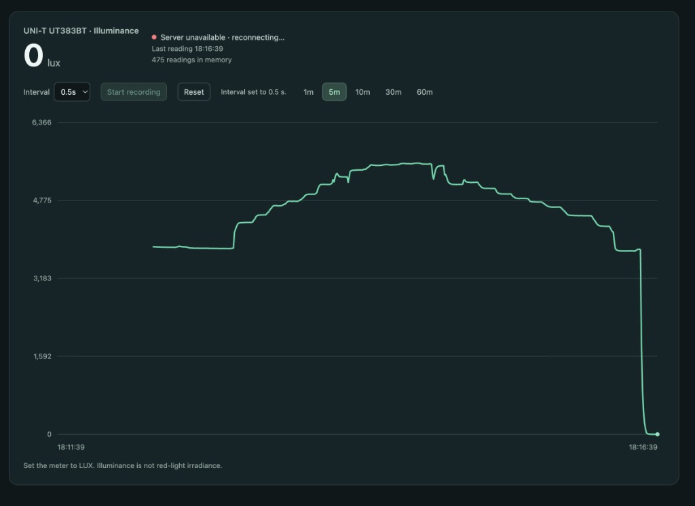

# UT383BT light meter

A local live dashboard for the UNI-T UT383BT Bluetooth lux meter. It reads illuminance over Bluetooth Low Energy, streams the values to a browser chart, and can save a recording as CSV.



This folder uses the existing [ut383bt-lux-ble-python](https://github.com/ddtdanilo/ut383bt-lux-ble-python) client by Danilo Díaz Tarascó. `requirements.txt` pins the upstream source to a specific commit. Python 3.11+ and Bluetooth Low Energy are required.

## Setup

```sh
python3 -m venv .venv
source .venv/bin/activate
python -m pip install -r requirements.txt
```

Enable Bluetooth on the meter by powering it on and long-pressing the power button. Set its unit to **LUX**. The upstream parser extracts numbers without strictly verifying the unit, so FC readings could be incorrectly labelled as lux. Close the UNI-T app if it is connected.

```sh
ut383bt scan --timeout 10
ut383bt read --device YOUR_IDENTIFIER --port 8085
ut383bt read --device YOUR_IDENTIFIER --duration 30
ut383bt log --device YOUR_IDENTIFIER --duration 60 --output readings.csv
```

Use the identifier from the scan; macOS uses a UUID. `log` appends to the given CSV file. Use `ut383bt read --help` and the upstream documentation for additional options.

This client connected to the meter and received live values. Compare its readings against the meter display before relying on them. Lux is illuminance, not red-light irradiance in mW/cm².

## Live dashboard

With the virtual environment activated and dependencies installed, turn on the meter and enable its Bluetooth, then start:

```sh
python server.py --device YOUR_IDENTIFIER
```

Open http://127.0.0.1:8080/ on this computer. To use a different port, start with `python server.py --device YOUR_IDENTIFIER --port 8081` and open http://127.0.0.1:8081/. The dashboard uses the upstream client and requests readings once per second by default; change the request interval in the page, set `--interval 0.5` for a different starting interval, or use `--port 8081` to change the HTTP port. The server pushes readings and status changes to the page over a WebSocket; the page reconnects automatically if the connection drops. The chart has rolling 1, 5, 10, 30 and 60 minute windows. The server keeps up to 60 minutes of readings in memory; restarting it clears the history. Use Start recording and Stop recording to save readings captured between those clicks as a CSV under `recordings/`. Filenames contain the UTC start date and time; timestamps in the file are UTC. Stopping the server normally also finishes an active recording. The Reset button clears the shared history for every open dashboard and collection continues. Connection interruptions appear in the status and the server retries automatically. Stop it with Ctrl-C. Only one application should connect to the meter at a time.

The server listens only on localhost. Leave the meter in LUX mode: the upstream parser does not reliably check units.

## License

Copyright (C) 2026 Aleksandr Motsjonov.

This project is free software, licensed under the [GNU General Public License v3.0](LICENSE) or any later version. The Bluetooth client it depends on, [ut383bt-lux-ble-python](https://github.com/ddtdanilo/ut383bt-lux-ble-python), is a separate project licensed under the WTFPL.
